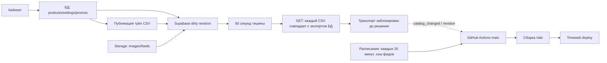

# Автообновление каталога: вариант C

Статус: подготовлено локально, в боевую БД ничего не применено. Supabase dispatch **заблокирован** до согласования транспорта: прямой `pg_net → GitHub` с PAT несовместим с требованием не помещать PAT в HTTP-очередь. Vault шифрует хранение секрета, но не заголовки исходящего запроса. [Документация Supabase](https://supabase.com/docs/guides/troubleshooting/database-roles-can-read-request-headers-queued-by-pg_net-ad6357) прямо исключает изменение grants/RLS этой очереди в проекте. Старый рецепт «ограничить grants net» использовать нельзя.

Контракт для Ипполита: `POST https://api.github.com/repos/arturablyazov5-glitch/lady-elka-cloud-preview/dispatches`, JSON `{"event_type":"catalog_changed","client_payload":{"revision":123}}`. Только HTTP **204** подтверждает приём события, не успешный деплой. Fine-grained PAT ограничивается этим репозиторием, Contents/Actions write; для самого repository_dispatch GitHub требует Contents write. [GitHub REST](https://docs.github.com/en/rest/repos/repos#create-a-repository-dispatch-event).

Новая миграция `20261010110000_catalog_ci_dispatch.sql` дополняет старую `20261008110000`: products/settings/promos и Storage images/feeds уже имеют триггеры. Каждый сигнал увеличивает revision и перезапускает 60 секунд тишины. После тишины pg_net делает шесть публичных GET без секретов: Storage и существующий прямой exporter для trees/decor/promos. Три HTTP200 и точное совпадение каждой пары обязательны; новая revision аннулирует предыдущую проверку. Поэтому commit цены, неудачная/частичная публикация и поздняя загрузка старого CSV не подтверждаются по одному Storage metadata событию. Workflow уже использует прямой exporter в двух одинаковых проходах; расписание может обновить сайт даже при сбое Storage-публикации.

При ошибке dispatch повтор возможен через две минуты после обнаружения ошибки; перед ним снова проверяются фиды. Нет ответа — timeout две минуты, затем такой же backoff. ACK относится к request_revision; новая revision не теряется. Потеря HTTP204 может привести к повторной доставке: гарантия exactly-once в распределённой цепочке отсутствует, workflow обязан иметь lock/проверку хэша. В здоровом локальном сценарии одна/десять правок дают ровно один dispatch.

Включение: [DEPLOY.md, «Каталог: GitHub Actions»](DEPLOY.md#каталог-github-actions-вариант-c). Сейчас доступен только резервный workflow по расписанию; безопасное включение прямого dispatch не подготовлено, функция транспорта намеренно отказывает, PAT не читается. Нет cron/расширений/секретов, создаваемых миграцией. Реальные workflow, /site и Timeweb относятся к работе Ипполита, их готовность здесь не заявляется.

Выключение одной SQL-командой: `select public.le_catalog_sync_disable();` — атомарно enabled=false, dirty-триггеры становятся неактивными, именованный cron удаляется. Триггеры/состояние/старые assets сохраняются для восстановления; существующий HTTP-запрос отменить этой командой нельзя. GitHub workflow по расписанию отключается отдельно на GitHub, откат опубликованного /site/Timeweb — на сохранённый релиз у Ипполита.

Диагностика: смотреть только revision/sent_revision, last_status, retry_at и diagnostic в state (команды в DEPLOY). `checking_feed_publication` — ожидаем ответы; `feeds_not_published` — несовпадение/ошибка/timeout; `dispatch_failed` — не204; `transport_blocked_or_failed` — безопасный отказ транспорта. Не выбирать Vault values, HTTP headers или тела ответов в общие логи.

Проверка локально: `node --test --test-concurrency=1 supabase/tests/catalog-ci-dispatch.test.mjs`. PGlite + настоящий локальный HTTP mock; SQL migration применяется дважды, pg_net worker имитируется, секретов нет. Это проверка машины состояний и контракта, не настоящего pg_net/Vault/GitHub/Timeweb. Боевой тест и применение требуют отдельного разрешения владельца.
